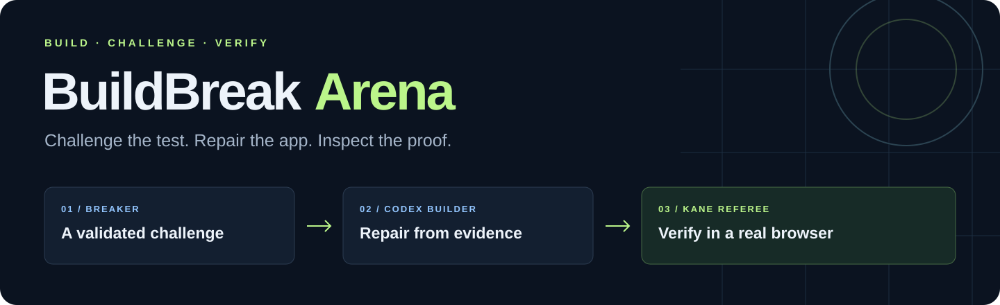
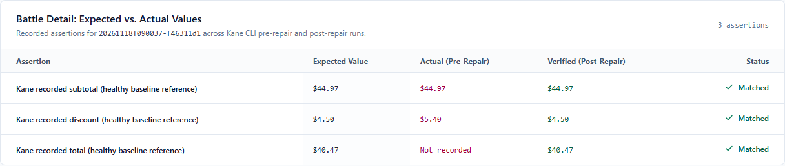
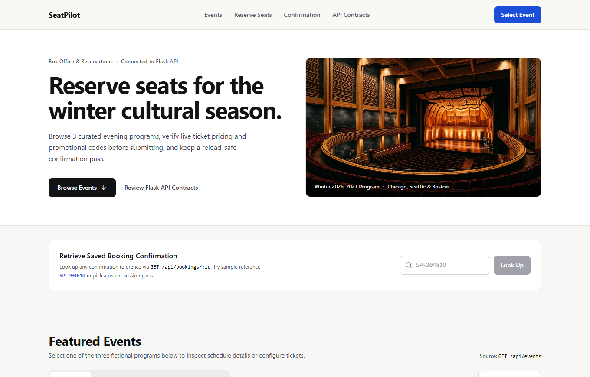

Gemini proposes a bug, Arena validates it, Kane CLI judges it, Codex repairs it. Built with Flask, SQLite, Codex and Kane CLI.

# BuildBreak Arena



[Try Arena locally](#quickstart) · [Inspect a recorded repair](#see-the-evidence) · [Launch a battle](#launch-through-the-dashboard) · [Explore the code](#repository-map)

## Why we built it

A checkout can look fine and still charge the wrong amount. When we built BreakShop, we wanted to answer two questions before shipping. Would our browser test notice a wrong discount? If it did, could a coding agent use that failure to repair the app and pass the **same test**?

Arena lets a developer rehearse that incident on a disposable copy. Give it a supported app and an acceptance test you trust. Arena checks the healthy flow, puts one measurable bug in the copy and follows it through detection and repair. You get a record of what the browser saw, how many repair attempts the Builder needed and which checks passed afterward. A proven bug that slips through the browser test is recorded as an **escape**.

## See the evidence

In one BreakShop run, the cart subtotal was **$44.97**. The discount should have been **$4.50**. After Gemini's change, Kane read **$5.40** in the browser. A fresh Codex session repaired the app on its first attempt. Kane then read **$4.50** and a **$40.47** total using the original test. The broken run stopped before it recorded a final total. [Read the November 18 run account](docs/evidence/gemini-pricing-battle-2026-11-18.md).



### The repair loop


| When you run a battle | What happens |
| --- | --- |
| **You approve the check** | Arena shows the acceptance test, protects its hash and runs the healthy baseline on an isolated copy with its own database. |
| **The Breaker proposes a fault** | Gemini proposes a bounded code edit. Arena validates the edit and checks its effect independently, for example by reading a saved order. |
| **Kane exercises the broken app** | Kane uses Chrome to run the approved test. A confirmed application failure sends evidence to the Builder. A pass despite a directly verified fault records an escape. |
| **Codex repairs from evidence** | A fresh Builder receives the broken source, written requirements and failure feedback. Arena checks the proposed repair and reruns the relevant automated checks. |
| **Kane verifies again** | The same browser test decides whether the exercised flow passes after repair. After three unsuccessful repair attempts, the battle goes to human review. Browser or infrastructure issues are tracked separately. |

## Quickstart

**Browse the shop and console locally without an account.** From a clone of this repository, run the commands for your platform.

**Windows PowerShell**

```powershell
python -m venv .venv
.\.venv\Scripts\python.exe -m pip install -r requirements.txt
.\.venv\Scripts\python.exe app.py
```

**macOS or Linux**

```sh
python3 -m venv .venv
.venv/bin/python -m pip install -r requirements.txt
.venv/bin/python app.py
```

Open the [Arena dashboard](http://127.0.0.1:5000/arena) or try two shirts, one sticker pack and SAVE10 in [BreakShop](http://127.0.0.1:5000). Use fictional checkout details. A fresh clone starts with empty battle history. To see an example before running agents, open the [recorded battle](docs/evidence/dashboard-project-battle.md) or the [labeled sample report](docs/evidence/sample-report.md).

## Launch through the dashboard


1. **Enable local execution.** Install Chrome and authenticate the Kane and Codex CLIs. For Gemini, configure its free-tier model and key in the shell that starts Arena. Stop the preview server first. In PowerShell set `$env:ARENA_ENABLE_LIVE_KANE = "1"`, then run the same app launch command. On macOS or Linux run `ARENA_ENABLE_LIVE_KANE=1 .venv/bin/python app.py`. [Setup guide](docs/guides/self-service.md) · [Gemini configuration](docs/guides/gemini-breaker.md).
2. **Choose a project.** Select **Use built-in BreakShop**, **Try SeatPilot ticket booking**, or import a supported source ZIP. Review the preflight checks and the acceptance test, then approve the test.
3. **Start full battle.** Select Gemini or the scripted demo. Watch the progress and Kane's isolated Chrome viewport. The feed is read-only while Kane drives the browser. [Live monitor guide](docs/guides/live-kane-monitor.md).
4. **Inspect the result.** Review expected and observed values, step through the timeline, open available verified screenshots and copy the battle summary. The live viewport shows activity. The verdict comes from the recorded verification. [Dashboard-launched BreakShop run](docs/evidence/dashboard-project-battle.md).

### Try the SeatPilot booking demo



SeatPilot is a second application with a different question to test. When someone reserves tickets, do the saved booking and remaining inventory agree? The adapter pairs the AI Studio React design with a local Flask API and a separate protected booking test. It requires Node.js and npm to build the frontend. The image shows the running website. Live Kane repair evidence published here covers BreakShop. [Supported imports and adapter limits](docs/guides/self-service.md).

## Run a real battle from the CLI

The default command starts a Gemini battle with a fresh Codex Builder and up to three repair attempts.

```powershell
.\.venv\Scripts\python.exe battle_runner.py --builder codex --max-attempts 3
```

On macOS or Linux use `.venv/bin/python battle_runner.py --builder codex --max-attempts 3`.

| Breaker option | When to use it |
| --- | --- |
| `--breaker gemini` (default) | Generate a bounded logic fault. Requires an environment-only API key, an available free model and explicit free-tier confirmation. |
| `--breaker scripted` | Use a prepared fault for a reproducible demo without a Gemini call. |
| `--breaker cached --cached-fault <file>` | Revalidate a privately saved Gemini proposal and replay it without a new Gemini call. |
| `--breaker codex` | Have Codex choose between two controlled faults. |

Missing Gemini configuration stops the run. If configured proposals fail validation or requests fail, the runner can use a validated controlled fallback and records the actual producer. **Offline fault selection** with scripted or cached mode still requires Kane access for browser verification and Codex access when using the Codex Builder. [Runner prerequisites](docs/guides/replayable-battles.md) · [Genuine cached replay](docs/evidence/cached-replay.md).

## What is proven?

| Question | Evidence and scope |
| --- | --- |
| Did the loop catch and repair a generated bug? | The November 18 BreakShop run recorded a healthy pass, a failure on the broken copy and a pass after one Codex repair. [Run account](docs/evidence/gemini-pricing-battle-2026-11-18.md). |
| Can a developer watch Kane use a site? | A standalone checkout verification showed changing Chrome frames inside Arena. A separate dashboard-launched BreakShop drill followed the baseline, failure and repair. [Viewport verification](docs/evidence/live-browser-view.md) · [Dashboard run](docs/evidence/dashboard-project-battle.md). |
| Which projects can run? | BreakShop and the reviewed SeatPilot export have explicit adapters. Other uploads receive a compatibility inspection. An arbitrary public URL provides insufficient source to inject and repair a fault. |
| How far does a pass generalize? | It covers the exercised flow. The dashboard summarizes eligible executions among the ten most recent records. Replaying a fault adds an execution. Broader coverage, a live SeatPilot repair and the effect of Kane feedback alone remain open questions. |

The Builder gets written requirements as well as failure evidence. The original healthy source, hidden patch and Git history stay outside its repair context. Generated repairs undergo code and environment checks. Run the tool locally with fictional data. Raw evidence, cookies, databases and fault caches stay local. [Execution boundary](docs/guides/execution-boundary.md) · [Unscored Builder feedback comparison](docs/guides/builder-ablation.md) · [Screenshot provenance](docs/guides/evidence-screenshots.md).

## Repository map

| Area | Where to look |
| --- | --- |
| App and CLI entry points | [app.py](app.py) · [battle_runner.py](battle_runner.py) |
| Runner, agents and validators | [buildbreak/](buildbreak/) |
| Dashboard design and Flask views | [frontend/](frontend/) · [templates/](templates/) |
| Ticket booking adapter and demo | [examples/seatpilot/](examples/seatpilot/) |
| Protected browser checks and offline tests | [.testmuai/tests/](.testmuai/tests/) · [tests/](tests/) |
| Recorded results and demo walkthrough | [Evidence accounts](docs/evidence/) · [Three-minute demo guide](docs/demo/demo-guide.md) |

Run the offline suite with `.\.venv\Scripts\python.exe -m unittest discover -s tests -t .` on Windows, or `.venv/bin/python -m unittest discover -s tests -t .` on macOS or Linux. Mocked tests exercise runner behavior. Published live results link to separate run accounts.

[Full documentation index](docs/README.md)
