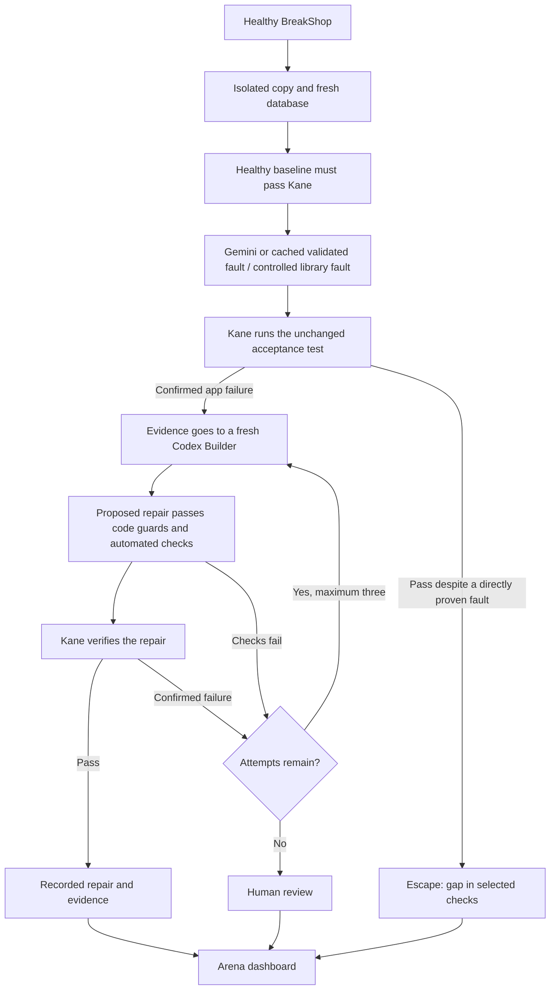
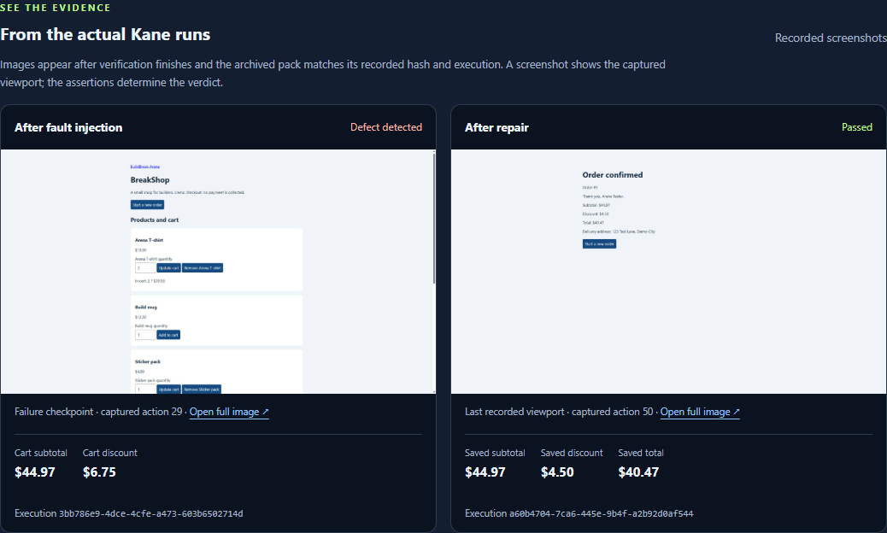
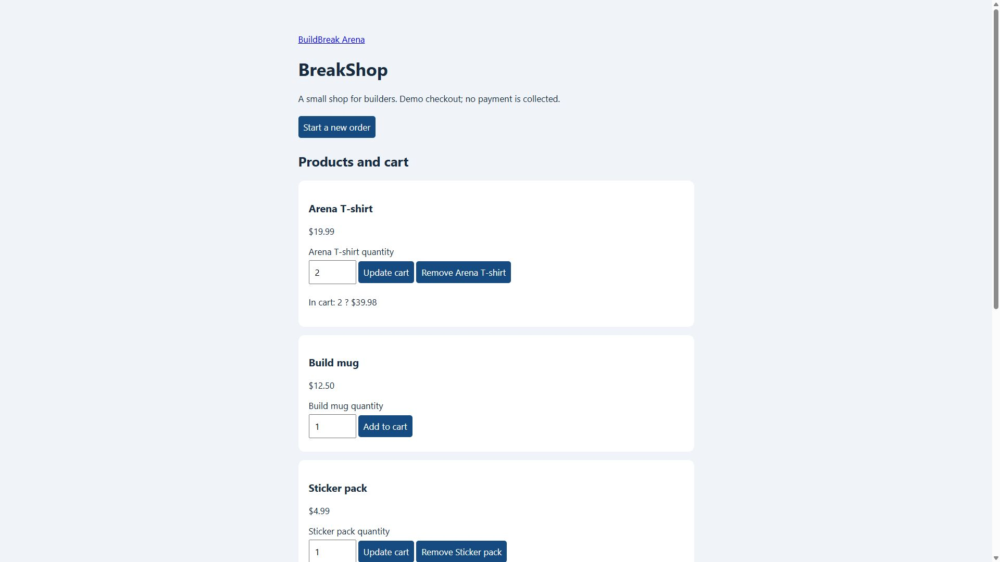
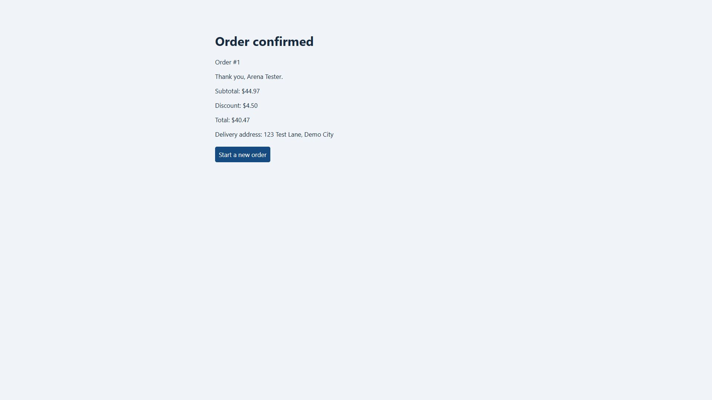

Gemini proposes a bug, Arena validates it, Kane CLI judges it, Codex repairs it. Built with Flask, SQLite, Codex and Kane CLI.

# BuildBreak Arena


<p align="center">
  <strong>Can your test catch the bug? Can your agent repair it? Show the evidence.</strong><br>
  Gemini is the default Breaker. Cached and scripted fault selection remain available.
</p>

<p align="center">
  <a href="#quickstart">Quickstart</a> ·
  <a href="#the-repair-loop">The loop</a> ·
  <a href="#repository-map">Code map</a> ·
  <a href="#see-the-evidence">Screenshots</a> ·
  <a href="#what-is-proven">Proof and limits</a> ·
  <a href="#project-guide">Guides</a>
</p>

## What is it?

**BuildBreak Arena checks whether a browser acceptance test catches a deliberate
logic bug, then whether a coding agent can repair it while that test stays unchanged.**

Arena creates a separate copy of the demo app, coordinates the Breaker and Builder,
asks Kane to verify the browser behavior, and records what actually happened.
If the test misses a proven defect, Arena records an escape. If repair does not
succeed within the attempt limit, it requests human review.

**Arena is the tool. BreakShop is its currently supported demonstration app.**
It is not yet a runner for arbitrary websites or production incident prediction.

## Repository map

```text
BuildBreak/
├── app.py                 # Start BreakShop and the Arena dashboard
├── battle_runner.py       # Start a battle with the familiar CLI
├── arena.py               # Small compatibility import for the frozen app source
├── requirements.txt
├── README.md
├── buildbreak/            # Implementation: runner, agents, validation and dashboard
├── tests/                 # Offline unit and integration tests
├── templates/             # Flask pages
├── static/                # Shop and dashboard styles
├── docs/
│   ├── guides/            # Setup, commands and safeguards
│   ├── evidence/          # Genuine run accounts and the labeled sample report
│   ├── demo/              # Presentation guide
│   ├── specs/             # BreakShop requirements
│   └── images/            # Reviewed screenshots and provenance
└── .testmuai/tests/        # Kane acceptance definitions; protected test stays here
```

[Implementation map](buildbreak/README.md) · [Test guide](tests/README.md) ·
[Documentation home](docs/README.md)

The root launchers stay small. The `arena.py` adapter preserves the hash-bound
BreakShop source and saved-cache compatibility; its implementation lives in
`buildbreak/arena.py`. Private local artifacts remain in ignored `instance/`.


*Actual dashboard, captured with genuine local history. Counts describe eligible
recorded executions, not website-wide quality or a statistical repair rate.*

## The repair loop



Baseline, authentication, browser and infrastructure problems stop verification
without being counted as caught application defects. Kane's final events,
process result and sealed evidence must agree before a browser verdict is accepted.

| Component | Its job |
| --- | --- |
| **Breaker** | Gemini proposes a bounded JSON patch, a validated cache replays one, or the controlled mode supplies a prepared fault. |
| **Codex Builder** | Receives broken source and genuine failure feedback in a fresh context; proposes a repair. |
| **Kane referee** | Uses the running app in a real browser, checks the frozen acceptance flow and records evidence. |
| **Arena runner** | Isolates the app, protects test hashes, checks candidate code, coordinates the loop and stores results. |

The Builder is not supplied the fault patch, its description, healthy source or
Git history. Generated repairs undergo syntax, route and sensitive-operation
checks before execution. Validated Gemini/cache repairs must also restore their
selected independent invariant. These guards are not an OS sandbox.

## See the evidence



**The dashboard now shows the captured failure viewport and the latest repair
viewport, with full-image links and their execution references.** Images appear
after verification finishes and the archived pack matches the recorded hash,
execution and test definition. Recognized currency observations are shown
separately; screenshots do not substitute for assertions.

The view above belongs to the real cached replay
`20261115T051420-5ba874b2`. It replayed an earlier Gemini-generated fault without
a Gemini API call during replay. Kane and Codex still used their services.

| What was measured | Recorded result |
| --- | --- |
| Required subtotal / discount / total | **$44.97 / $4.50 / $40.47** |
| Kane's faulted cart observation | **$6.75 discount**; failed before checkout |
| Separate direct database check | **$38.22 saved total** on the faulted fixture |
| After Codex repair | **$40.47 saved total**; Kane checkout and confirmation reload passed |

The failure screenshot shows the top of the shop; its wrong discount was recorded
outside the visible viewport. We keep that distinction explicit. These are
historical results, not a new live run of the screenshot feature.

<details>
<summary>Open the original selected Kane frames</summary>

| Failure checkpoint | Repaired confirmation |
| --- | --- |
|  |  |

Failure execution: `3bb786e9-4dce-4cfe-a473-603b6502714d`.<br>
Repair execution: `a60b4704-7ca6-445e-9b4f-a2b92d0af544`.

The two JPEGs are unchanged copies of selected frames. See
[screenshot provenance and privacy](docs/guides/evidence-screenshots.md) and
[the verified replay account](docs/evidence/cached-replay.md).

</details>

Raw packs, logs, cookies, credentials, databases and caches stay out of Git.
Only the reviewed demo images are included here. Local previews are recorded
screenshots; Arena does not embed live browser video.

## Quickstart

**Try the app first — no API key or agent login needed.** From a downloaded or
cloned repository folder, create the environment and install the dependencies.
This is an app-only five-minute quickstart; download times vary.

**Windows PowerShell**

```powershell
python -m venv .venv
.\.venv\Scripts\python.exe -m pip install -r requirements.txt
.\.venv\Scripts\python.exe app.py
```

**macOS / Linux**

```sh
python3 -m venv .venv
.venv/bin/python -m pip install -r requirements.txt
.venv/bin/python app.py
```

Open [BreakShop](http://127.0.0.1:5000) and [Arena](http://127.0.0.1:5000/arena).
Try two shirts and one sticker pack with SAVE10. Use fictional checkout details;
no payment is taken. Stop the server with **Ctrl+C**. Activation is unnecessary.

**A fresh Arena starts empty.** The images above are historical examples, not
preloaded results. Read the [SAMPLE report](docs/evidence/sample-report.md) without
creating fake history. A real battle records its own results automatically.

Orders persist in ignored `instance/shop.sqlite3`. A random development session
secret is created on startup. Set a private `SECRET_KEY` environment variable
for session continuity if needed. Flask's development server is for this local demo.

## Run a real battle

You need local Chrome and your own installed, authenticated **Kane CLI and Codex
CLI**, with available account allowances. The app-only quickstart needs neither.
See [runner prerequisites and troubleshooting](docs/guides/replayable-battles.md).

Gemini is the default Breaker. With its free-tier configuration set, run:

```powershell
.\.venv\Scripts\python.exe battle_runner.py --builder codex --max-attempts 3
```

```sh
.venv/bin/python battle_runner.py --builder codex --max-attempts 3
```

Missing Gemini configuration stops the run before Kane uses credits; it never
silently switches modes. After configured Gemini proposals fail validation or
API requests fail, the existing bounded process can use an explicitly recorded,
validated controlled fallback. The history identifies the actual producer.

For fault selection without a Gemini API call, use a validated local cache with
`--breaker cached --cached-fault <file>`, or the scripted demo below. A full battle
still needs Kane and, with `--builder codex`, Codex access. The runner starts its
own isolated app; your main shop is preserved.

```powershell
.\.venv\Scripts\python.exe battle_runner.py --breaker scripted --builder codex --max-attempts 3
```

```sh
.venv/bin/python battle_runner.py --breaker scripted --builder codex --max-attempts 3
```

Keep the main app running in a separate terminal and open `/arena` to follow
recorded progress. The dashboard cannot launch agents or execute shell commands.

| Mode | When to use it |
| --- | --- |
| `--breaker scripted` | Predictable prepared fault; demonstration fallback. |
| `--breaker codex` | Codex chooses between two controlled faults. |
| `--breaker gemini` (default) | Gemini proposes a small logic fault; Arena validates it before acceptance. Requires `GEMINI_API_KEY`. |
| `--breaker cached --cached-fault <file>` | Revalidate and replay a local cached Gemini proposal without calling Gemini. |

Gemini requires an environment-only key, an available model and
explicit confirmation of free-tier access with billing disabled. Arena cannot
verify billing status. See [Gemini setup and cache commands](docs/guides/gemini-breaker.md).
Cached replay still consumes Kane/Codex allowances and needs a private cache
created locally; caches are not bundled in a clone.

## What is proven?

| Capability | Evidence and current limit |
| --- | --- |
| Generated pricing drill | [Real Gemini → Kane → Codex → Kane run](docs/evidence/gemini-first-battle.md), caught and repaired. |
| Gemini default-mode drill | [November 17 live run](docs/evidence/gemini-default-battle.md): one rejection, second proposal accepted, repaired on attempt 1. Repeats the existing pricing case. |
| Cached replay | [Real repeat execution](docs/evidence/cached-replay.md), repaired without a Gemini call during replay. Same fault, not another bug discovery. |
| Quantity-boundary faults | Separate direct probe accepts 99, rejects 100 without cart changes, and removes at zero. Local/mocked tests pass; a live quantity battle is pending. |
| Builder feedback comparison | [Requirements-only ablation option](docs/guides/builder-ablation.md), one attempt and excluded from scores. No live comparison yet. |
| Requirements-to-test workflow | [Manual Kane feasibility gate](docs/evidence/kane-feasibility.md): partial exploration, approved requirements fallback, eight generated browser steps passed once. Not automatic onboarding. |
| Screenshot dashboard | Genuine existing packs displayed in desktop/mobile Chrome. No new Kane dashboard verification is claimed. |

Passing the checkout test does not prove full-app correctness, security or
production readiness. The supported fault space and independent probes are
explicit. The Builder also receives written expected amounts; we have not
established how much Kane feedback improves repair success. Context separation
and environment guards reduce accidental exposure; see the
[local execution boundary](docs/guides/execution-boundary.md).

The dashboard summarizes eligible executions among the **10 most recent records**.
Interrupted, unfinished, unvalidated and requirements-only experiment records are
excluded from scores. A repeated cached patch counts as another execution, not
broader coverage. Missing screenshots leave saved verdicts unchanged.

## Project guide

| Start here | Read more |
| --- | --- |
| Browse the organized documentation | [Documentation home](docs/README.md) |
| Understand the runner | [Replayable battles](docs/guides/replayable-battles.md) |
| Configure Gemini or build a cache | [Gemini Breaker](docs/guides/gemini-breaker.md) |
| Inspect screenshot provenance | [Recorded screenshots](docs/guides/evidence-screenshots.md) |
| Read a result without running agents | [SAMPLE report](docs/evidence/sample-report.md) |
| Prepare the presentation | [Three-minute demo guide](docs/demo/demo-guide.md) |
| Import the first human-triggered experiment | [Historical dashboard setup](docs/guides/historical-dashboard.md) |
| Check the stronger test contract | [Checkout consistency](docs/evidence/checkout-consistency.md) |

Run the local unit suite:

```powershell
.\.venv\Scripts\python.exe -m unittest discover -v
```

```sh
.venv/bin/python -m unittest discover -v
```

Unit-test agent/browser responses are synthetic fixtures, not live-run evidence.
Development verification ran on Windows; macOS/Linux commands are provided but
those platforms have not been tested in this session.

---

**A controlled challenge. An evidence-driven repair. An unchanged browser test.**
